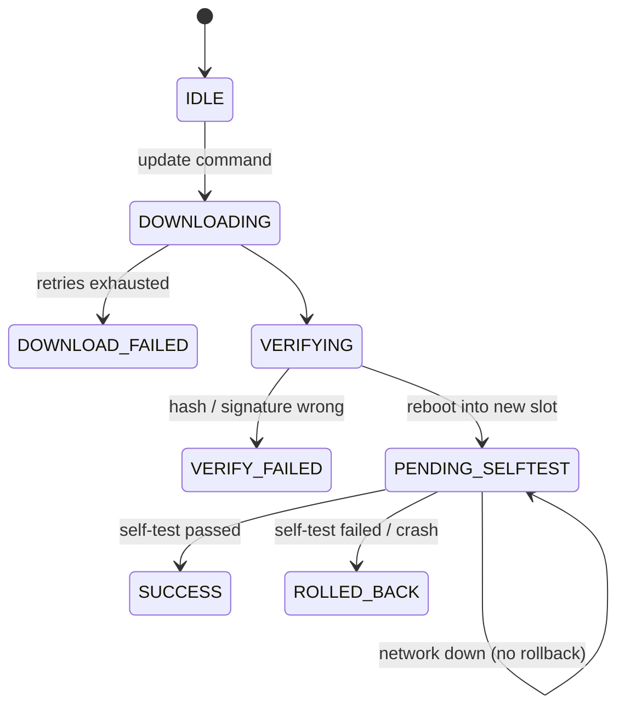

# MQTT contract

Every MediBox device – the real ESP32 firmware and the simulated device – speaks exactly this
contract. The controller never needs to know which kind of device it is talking to.
The machine-readable version (zod schemas) is in [`packages/contract/src/mqtt.ts`](../packages/contract/src/mqtt.ts).

All payloads are JSON (UTF-8). `<id>` is the device ID, e.g. `medibox-01`.

| Topic | Direction | QoS | Retained | Payload |
|---|---|---|---|---|
| `medibox/<id>/telemetry` | device → backend | 1 | no | `Telemetry` |
| `medibox/<id>/online` | device → backend | 1 | yes | `OnlineMessage` (also the MQTT last will) |
| `medibox/<id>/status` | device → backend | 1 | yes | `DeviceStatus` |
| `medibox/<id>/cmd/update` | controller → device | 1 | yes | `UpdateCommand`, empty payload = no update |

## Telemetry (M1)

```json
{ "deviceId": "medibox-01", "fwVersion": "1.0.0", "seq": 1042, "ts": 1764147600000,
  "type": "temperature", "celsius": 21.5 }

{ "deviceId": "medibox-01", "fwVersion": "1.0.0", "seq": 1043, "ts": 1764147612000,
  "type": "box", "open": true }
```

- `seq` increases by 1 for every message and is persisted (NVS), so it keeps increasing across
  reboots. The backend uses `(deviceId, seq)` for deduplication and gap detection (M9).
- `ts` is the creation time on the device (Unix ms, SNTP). It stays the original time when a
  message is resent after an outage (store-and-forward). `null` if the clock was not synced yet.

## Online / offline

On connect the device publishes `{"online": true, "fwVersion": "1.0.0"}` (retained) and registers
the last will `{"online": false}` on the same topic. The broker publishes the last will when the
device disappears, so the controller can tell **offline** (not a failure) from **failed**.

## Update state (M2, M3)

```json
{ "deviceId": "medibox-02", "fwVersion": "1.0.0", "state": "ROLLED_BACK",
  "rolloutId": "1.1.0@3f2a9c1", "targetVersion": "1.1.0", "reason": "selftest:sensor", "ts": 1764147700000 }
```

| State | Meaning | Counts as rollout failure (M6)? |
|---|---|---|
| `IDLE` | no update in progress | – |
| `DOWNLOADING` | image is being written to the inactive slot | – |
| `DOWNLOAD_FAILED` | download failed after the device's own retries (network) | **no** – retried later |
| `VERIFYING` | checking SHA-256 and signature | – |
| `VERIFY_FAILED` | hash or signature wrong, image never booted | **yes** |
| `PENDING_SELFTEST` | booted into the new image, self-test running / waiting for network | – |
| `SUCCESS` | self-test passed, image confirmed as last known good | – |
| `ROLLED_BACK` | device returned to the previous slot on its own (local rollback) | **yes** |

A device that is offline or silent is **never** counted as failed – the rollout waits and is
paused after the health deadline.

## Update command (M5)

```json
{ "rolloutId": "1.1.0@3f2a9c1", "version": "1.1.0",
  "url": "https://github.com/Zafersari/medibox-gitops/releases/download/fw-v1.1.0/medibox-1.1.0.bin",
  "sha256": "…64 hex…", "signature": "…base64…", "issuedAt": 1764147650000 }
```

The command is **retained**: a device that was offline receives it as soon as it reconnects.
The device remembers the `rolloutId` of a release that failed on it and does not try it again.
`signature` is a detached ECDSA P-256 / SHA-256 signature over the binary (DER, base64),
verified with the public key built into the firmware.


